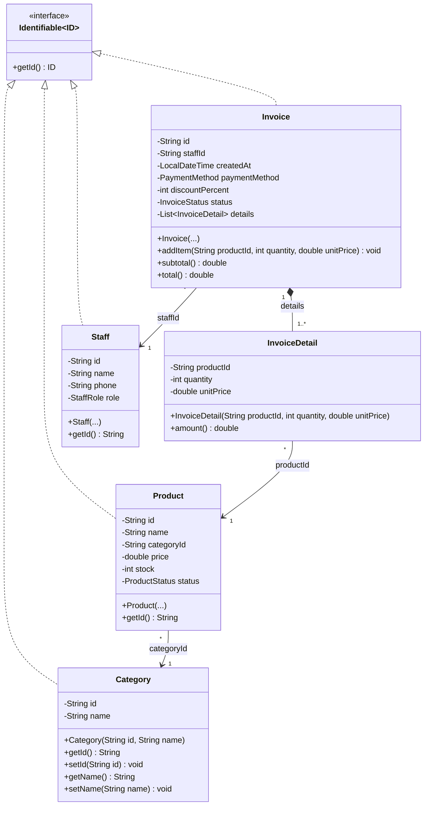

# Đặc tả yêu cầu – Đề tài 1: Quầy cà phê (POS)

> **Tài liệu chuẩn của nhóm phát triển (`coffee-shop-management-system`).**  
> Tài liệu này xác định *phần mềm phải làm được gì* (Mục 1–7), *lộ trình triển khai theo tiến độ học* (Mục 8) và *thiết kế chi tiết các lớp* (Mục 9).

| Thông tin dự án | Chi tiết |
| :--- | :--- |
| **Tên hệ thống** | Coffee Shop Management & POS System (`coffee-shop-management-system`) |
| **Môn học / Quy mô** | MOB1024 · Nhóm 4 thành viên · 18 buổi |
| **Cơ sở dữ liệu** | `cafe_pos` (SQL Server – Giai đoạn 2) |
| **Nhóm thực hiện** | **Nam** (Leader), **Thiện**, **Tuấn**, **Bình** |

---

## 1. Tổng quan

### 1.1 Mục tiêu
Xây dựng phần mềm console phục vụ vận hành một quán cà phê nhỏ: thu ngân chọn món, lập hóa đơn nhiều món và thu tiền; tồn kho hàng hóa tự động giảm khi bán và hoàn lại khi hủy đơn; quản lý theo dõi danh mục, sản phẩm, nhân sự, nhập hàng và xem báo cáo thống kê doanh thu.
* **Giai đoạn 1 (GĐ1):** Lưu trữ dữ liệu bằng tệp nhị phân (`data/*.dat`).
* **Giai đoạn 2 (GĐ2):** Lưu trữ dữ liệu bằng SQL Server (`cafe_pos`), giữ nguyên toàn bộ giao diện và luồng xử lý nghiệp vụ.

### 1.2 Phạm vi hệ thống

| Trong phạm vi (Phải làm) | Ngoài phạm vi (Không cần làm) |
| :--- | :--- |
| Quản lý danh mục, sản phẩm, nhân viên, hóa đơn nhiều món | Đăng nhập bằng mật khẩu (chỉ cần chọn nhân viên trực ca) |
| Bán hàng, tính giảm giá, hủy hóa đơn, nhập thêm hàng | Công thức pha chế, định lượng trừ nguyên liệu theo từng ly |
| Tìm kiếm đa tiêu chí, sắp xếp, phân trang kết quả | Kết nối máy in hóa đơn vật lý, máy quẹt thẻ |
| Thống kê doanh thu và xuất báo cáo ra tệp HTML | Giao diện đồ họa Swing/JavaFX (chỉ là điểm cộng) |
| Chuyển đổi (di trú) dữ liệu từ File sang SQL Server | Phân quyền chi tiết theo từng nút bấm phức tạp |

### 1.3 Người dùng & Phân quyền

| Vai trò (`StaffRole`) | Quyền hạn chức năng |
| :--- | :--- |
| **Thu ngân (`CASHIER`)** | Chọn ca trực, lập hóa đơn bán hàng, tìm kiếm & xem danh sách sản phẩm |
| **Quản lý (`MANAGER`)** | Toàn bộ quyền của Thu ngân + quản lý danh mục, sản phẩm, nhân viên, hủy hóa đơn, nhập hàng, tra cứu hóa đơn, xem thống kê, xuất báo cáo HTML và chuyển dữ liệu File $\rightarrow$ DB |

### 1.4 Thuật ngữ nghiệp vụ

| Thuật ngữ | Định nghĩa |
| :--- | :--- |
| **Hóa đơn (`Invoice`)** | Một lần thanh toán của khách hàng, bao gồm thông tin chung và danh sách các dòng chi tiết |
| **Dòng chi tiết (`InvoiceDetail`)** | Một mặt hàng trong hóa đơn gồm mã sản phẩm, số lượng và đơn giá **tại thời điểm bán** |
| **Tồn kho (`stock`)** | Số lượng sản phẩm hiện còn sẵn sàng để bán tại quán |
| **Ngừng bán (`STOPPED`)** | Sản phẩm vẫn lưu trong hệ thống để bảo toàn lịch sử hóa đơn cũ nhưng không được phép bán mới |

---

## 2. Yêu cầu chức năng & Phân công thành viên

*Quy ước: **GĐ1** = Lưu File `.dat`, **GĐ2** = Lưu SQL Server `cafe_pos`.*

| Mã | Chức năng | Người dùng | GĐ1 | GĐ2 | Slide | Phụ trách |
| :--- | :--- | :--- | :---: | :---: | :---: | :--- |
| **FR-01** | Thêm / sửa / xóa / xem danh mục | Quản lý | ✔ | ✔ | 1, 2, 4 | **Thiện** |
| **FR-02** | Thêm / sửa / xóa / xem sản phẩm, đổi trạng thái đang bán – ngừng bán | Quản lý | ✔ | ✔ | 1, 2, 4 | **Thiện** |
| **FR-03** | Thêm / sửa / xóa / xem nhân viên | Quản lý | ✔ | ✔ | 1, 2 | **Tuấn** |
| **FR-04** | Chọn nhân viên trực ca khi khởi động | Tất cả | ✔ | ✔ | 2 | **Tuấn** |
| **FR-05** | **Lập hóa đơn nhiều món và thanh toán** | Thu ngân | ✔ | ✔ Transaction | 3, 4, 7 | **Nam** |
| **FR-06** | **Hủy hóa đơn đã thanh toán, cộng trả tồn kho** | Quản lý | ✔ | ✔ Transaction | 4, 7 | **Nam** |
| **FR-07** | **Nhập thêm hàng cho nhiều sản phẩm một lần** | Quản lý | ✔ | ✔ Batch | 7 | **Thiện** |
| **FR-08** | Tìm sản phẩm nhiều tiêu chí + sắp xếp + phân trang | Tất cả | ✔ | ✔ | 3, 6 | **Thiện** |
| **FR-09** | Tra cứu hóa đơn nhiều tiêu chí + phân trang, hiện tên nhân viên và tổng tiền | Quản lý | ✔ | ✔ JOIN | 3, 6 | **Tuấn** |
| **FR-10** | Thống kê doanh thu (Mục 6) | Quản lý | ✔ | ✔ | 3, 8 | **Bình** |
| **FR-11** | Xuất báo cáo doanh thu ra tệp HTML | Quản lý | ✔ | ✔ | 5, 8 | **Bình** |
| **FR-12** | Lưu toàn bộ dữ liệu, mở lại chương trình dữ liệu còn nguyên | — | ✔ | ✔ | 5, 6 | **Bình** |
| **FR-13** | Chọn nguồn dữ liệu File / SQL Server khi khởi động | — | ✔ | ✔ | 1, 4 | **Nam** |
| **FR-14** | Chuyển dữ liệu từ File vào SQL Server | Quản lý | — | ✔ | 5, 6, 7 | **Nam** |

### 2.1 Đặc tả chi tiết các chức năng trọng tâm

#### `FR-05`: Lập hóa đơn nhiều món và thanh toán
* **Đầu vào:** Nhân viên trực ca (`staffId`); danh sách cặp `(productId, quantity)`; phương thức thanh toán (`PaymentMethod`); phần trăm giảm giá (`0–50%`).
* **Luồng xử lý chính:**
  1. Thu ngân nhập mã sản phẩm và số lượng. Nếu nhập lại sản phẩm đã có trong giỏ hàng thì **cộng dồn** số lượng.
  2. Sau mỗi lần thêm món, hiển thị bảng giỏ hàng hiện tại: mã/tên món, số lượng, đơn giá, thành tiền từng dòng và tổng tạm tính (`subtotal`).
  3. Thu ngân chọn kết thúc chọn món, chọn phương thức thanh toán (`CASH`, `CARD`, `E_WALLET`) và nhập phần trăm giảm giá (`0–50%`).
  4. Hệ thống hiển thị số tiền giảm, tổng tiền khách phải trả (`total`) và yêu cầu xác nhận.
  5. Khi xác nhận: hệ thống tự sinh mã hóa đơn `HDyyyyMMdd-nnnn`, lưu hóa đơn trạng thái `PAID`, trừ tồn kho tương ứng của từng sản phẩm và thông báo thành công.
* **Luồng ngoại lệ:** Mã sản phẩm không tồn tại $\rightarrow$ báo lỗi, cho nhập lại; sản phẩm đang `STOPPED` $\rightarrow$ chặn theo `BR-03`; số lượng vượt tồn kho $\rightarrow$ chặn theo `BR-04`; giỏ hàng rỗng mà xác nhận thanh toán $\rightarrow$ từ chối lập hóa đơn.
* **Tiêu chí nghiệm thu:** Hóa đơn chỉ được tạo khi **tất cả** các món trong giỏ đều đủ tồn kho. Nếu có dù chỉ 1 món thiếu hàng ở bước lưu, toàn bộ giao dịch phải rollback: không món nào bị trừ kho và không sinh hóa đơn (`TC-02`).

#### `FR-06`: Hủy hóa đơn đã thanh toán
* **Đầu vào:** Mã hóa đơn cần hủy (`invoiceId`).
* **Luồng xử lý chính:** Hiển thị thông tin hóa đơn và các dòng chi tiết $\rightarrow$ yêu cầu quản lý xác nhận $\rightarrow$ chuyển trạng thái hóa đơn sang `CANCELLED` $\rightarrow$ cộng hoàn trả lại số lượng tồn kho cho từng sản phẩm trong hóa đơn.
* **Luồng ngoại lệ:** Không tìm thấy mã hóa đơn $\rightarrow$ báo lỗi `NotFoundException`; hóa đơn đã ở trạng thái `CANCELLED` trước đó $\rightarrow$ chặn theo `BR-06`.
* **Tiêu chí nghiệm thu:** Cập nhật trạng thái hóa đơn và cộng trả tồn kho nằm trong cùng một Transaction (`TC-04`).

#### `FR-07`: Nhập thêm hàng theo lô
* **Đầu vào:** Danh sách các cặp `(productId, quantityAdded)`.
* **Luồng xử lý chính:** Quản lý nhập liên tiếp mã sản phẩm và số lượng nhập thêm $\rightarrow$ xác nhận lưu lô nhập $\rightarrow$ cộng dồn số lượng vào `stock` của từng sản phẩm.
* **Tiêu chí nghiệm thu:** Toàn bộ danh sách phải hợp lệ mới cập nhật; nếu có 1 mã sản phẩm sai hoặc số lượng $\le 0$, rollback toàn bộ lô nhập (`TC-06`).

---

## 3. Quy tắc nghiệp vụ (`BR`)

| Mã quy tắc | Nội dung ràng buộc bắt buộc |
| :--- | :--- |
| **BR-01** | **Duy nhất mã định danh:** Mã danh mục (`DM01`), sản phẩm (`SP01`), nhân viên (`NV01`), hóa đơn (`HDyyyyMMdd-nnnn`) không được trùng lặp. Nếu trùng ném `DuplicateIdException`. |
| **BR-02** | **Hợp lệ dữ liệu đầu vào:** Tên không được rỗng; giá bán $> 0$; tồn kho $\ge 0$; số lượng mua/nhập $\ge 1$; giảm giá từ `0` đến `50%`; số điện thoại nhân viên gồm đúng 10 chữ số và bắt đầu bằng `0`. |
| **BR-03** | **Trạng thái kinh doanh:** Không được phép thêm vào giỏ hoặc thanh toán sản phẩm đang có trạng thái `STOPPED` ("Ngừng bán"). |
| **BR-04** | **Giới hạn tồn kho:** Tổng số lượng mua của một sản phẩm trong giỏ không được vượt quá tồn kho hiện có (`stock`). Kiểm tra cả lúc thêm món vào giỏ và lúc xác nhận thanh toán. |
| **BR-05** | **Toàn vẹn tham chiếu khi xóa:** Không được xóa danh mục đang có sản phẩm thuộc về; không được xóa sản phẩm hoặc nhân viên đã phát sinh hóa đơn trong hệ thống. |
| **BR-06** | **Điều kiện hủy đơn:** Chỉ cho phép hủy hóa đơn đang ở trạng thái `PAID`. Hóa đơn đã `CANCELLED` không được hủy lại lần hai. |
| **BR-07** | **Bảo toàn lịch sử giá:** `InvoiceDetail` lưu cứng `unitPrice` tại thời điểm lập hóa đơn. Việc cập nhật giá mới cho `Product` sau này không được làm thay đổi giá trị các hóa đơn cũ. |
| **BR-08** | **Phạm vi tính doanh thu:** Tất cả chỉ số doanh thu và số lượng bán ra chỉ tính trên các hóa đơn có trạng thái `PAID`, loại bỏ hoàn toàn các hóa đơn `CANCELLED`. |

---

## 4. Dữ liệu mẫu & Lược đồ CSDL (`cafe_pos`)

### 4.1 Dữ liệu mẫu khởi tạo (`SampleData`)
Hệ thống cung cấp bộ dữ liệu mẫu chuẩn phục vụ kiểm thử ngay từ khi khởi động:
* **4 Danh mục:** `DM01` (Cà phê), `DM02` (Trà & Trà sữa), `DM03` (Nước đóng chai), `DM04` (Bánh ngọt).
* **15 Sản phẩm (`SP01`–`SP15`):** Phân bổ đều cho 4 danh mục; bao gồm sản phẩm tồn kho thấp (`stock < 10` như `SP08`, `SP10`, `SP15`) để kiểm thử cảnh báo hết hàng và sản phẩm ngừng bán (`SP12` – `STOPPED`) để kiểm thử `BR-03`.
* **4 Nhân viên (`NV01`–`NV04`):** `NV01` (`MANAGER`), `NV02`–`NV04` (`CASHIER`).
* **30 Hóa đơn mẫu (GĐ2):** Trải đều trong nhiều ngày, nhiều nhân viên lập đơn, đầy đủ 3 phương thức thanh toán và có cả đơn `PAID` lẫn `CANCELLED`.

### 4.2 Cấu trúc bảng SQL Server (`cafe_pos`)
1. **`categories`**: `id VARCHAR(10) PRIMARY KEY`, `name NVARCHAR(100) NOT NULL`
2. **`products`**: `id VARCHAR(10) PRIMARY KEY`, `name NVARCHAR(150) NOT NULL`, `category_id VARCHAR(10) FOREIGN KEY`, `price DECIMAL(12,2) CHECK (price > 0)`, `stock INT CHECK (stock >= 0)`, `status VARCHAR(20) NOT NULL`
3. **`staff`**: `id VARCHAR(10) PRIMARY KEY`, `name NVARCHAR(100) NOT NULL`, `phone VARCHAR(15) NOT NULL`, `role VARCHAR(20) NOT NULL`
4. **`invoices`**: `id VARCHAR(20) PRIMARY KEY`, `staff_id VARCHAR(10) FOREIGN KEY`, `created_at DATETIME2 NOT NULL`, `payment_method VARCHAR(20) NOT NULL`, `discount_percent INT CHECK (discount_percent BETWEEN 0 AND 50)`, `status VARCHAR(20) NOT NULL`
5. **`invoice_details`**: `invoice_id VARCHAR(20) FOREIGN KEY`, `product_id VARCHAR(10) FOREIGN KEY`, `quantity INT CHECK (quantity >= 1)`, `unit_price DECIMAL(12,2) CHECK (unit_price > 0)`, `PRIMARY KEY (invoice_id, product_id)`

---

## 5. Yêu cầu phi chức năng (`NFR`)

| Mã | Yêu cầu | Tiêu chuẩn áp dụng |
| :--- | :--- | :--- |
| **NFR-01** | **Chống crash khi nhập liệu** | Mọi thao tác nhập chuỗi, số nguyên, số thực, ngày tháng, chọn enum đều đi qua lớp tiện ích `ui.Input`; nhập sai định dạng thì báo lỗi tiếng Việt và yêu cầu nhập lại. |
| **NFR-02** | **Kiến trúc phân tầng độc lập** | Tách biệt rõ `ui` $\rightarrow$ `service` $\rightarrow$ `repository` / `model`. Tuyệt đối không dùng `Scanner` hoặc `System.out.println` bên trong tầng `service`, `repository` và `model`. |
| **NFR-03** | **An toàn truy vấn SQL** | 100% câu lệnh SQL có tham số đầu vào phải sử dụng `PreparedStatement` (`?`), tuyệt đối không nối chuỗi trực tiếp giá trị người dùng nhập. |
| **NFR-04** | **Toàn vẹn giao dịch** | Các nghiệp vụ cập nhật nhiều bảng/nhiều dòng (lập hóa đơn, hủy hóa đơn, nhập kho theo lô, di trú dữ liệu) phải chạy trong `Transaction` (`setAutoCommit(false)`). |
| **NFR-05** | **Phục hồi tệp hỏng (GĐ1)** | Khi đọc tệp `data/*.dat` nếu phát hiện tệp bị lỗi cấu trúc/hỏng dữ liệu, tự động đổi tên sao lưu sang `.bak` và khởi tạo tập rỗng an toàn. |
| **NFR-06** | **Chuẩn định dạng hiển thị** | Tiền tệ hiển thị dạng `35,000 đ` (`#,### đ`); ngày giờ hiển thị dạng `dd/MM/yyyy HH:mm`. |

---

## 6. Yêu cầu thống kê & Báo cáo (`FR-10`, `FR-11`)

Tất cả chỉ số thống kê dưới đây áp dụng quy tắc **`BR-08`** (chỉ tính hóa đơn `PAID`):
* **TK-01 – Doanh thu theo ngày:** Thống kê theo từng ngày gồm ngày, số lượng hóa đơn thành công và tổng doanh thu (`record DailyRevenue`).
* **TK-02 – Top sản phẩm bán chạy:** Xếp hạng sản phẩm theo tổng số lượng bán ra và tổng doanh thu mang lại (`record ProductSales`).
* **TK-03 – Doanh thu theo nhân viên:** Tổng hợp số đơn và tổng doanh thu từng nhân viên đã lập.
* **TK-04 – Thống kê theo phương thức thanh toán:** Số lượng hóa đơn và tổng tiền theo từng hình thức (`Tiền mặt`, `Thẻ`, `Ví điện tử`).
* **TK-05 – Tổng quan theo khoảng thời gian:** Tổng doanh thu, số đơn `PAID` và số đơn `CANCELLED` từ ngày A đến ngày B.
* **TK-06 – Giá trị đơn trung bình (AOV):** `Tổng doanh thu / Tổng số hóa đơn PAID`.
* **TK-07 – Cảnh báo tồn kho & Trạng thái:** Danh sách sản phẩm sắp hết hàng (`stock < 10`) và danh sách sản phẩm đang `STOPPED`.

---

## 7. Kịch bản kiểm thử trọng tâm (`TC`)

| Mã TC | Tình huống kiểm thử | Kết quả mong đợi |
| :--- | :--- | :--- |
| **TC-01** | Lập hóa đơn hợp lệ gồm nhiều món, có cộng dồn món nhập trùng và giảm giá `10%` | Sinh mã `HDyyyyMMdd-nnnn`, tính đúng tổng tiền, trừ đúng tồn kho từng món. |
| **TC-02** | Lập hóa đơn có 2 món: món 1 đủ hàng, món 2 vượt quá tồn kho | Báo lỗi thiếu hàng; món 1 **không** bị trừ tồn kho; không sinh hóa đơn mới. |
| **TC-03** | Thêm sản phẩm trạng thái `STOPPED` vào giỏ hàng | Hệ thống từ chối và thông báo sản phẩm đã ngừng kinh doanh (`BR-03`). |
| **TC-04** | Quản lý hủy một hóa đơn đang ở trạng thái `PAID` | Hóa đơn chuyển sang `CANCELLED`; tồn kho các món trong đơn được cộng trả đầy đủ. |
| **TC-05** | Thực hiện hủy lại hóa đơn đã có trạng thái `CANCELLED` | Báo lỗi từ chối hủy và không cộng trùng tồn kho lần hai (`BR-06`). |
| **TC-06** | Nhập kho theo lô 3 sản phẩm, trong đó mã sản phẩm thứ 3 không tồn tại | Báo lỗi không tìm thấy mã; 2 sản phẩm đầu không bị cộng tồn kho. |
| **TC-07** | Đổi giá bán của `SP01` từ `25,000 đ` lên `30,000 đ` sau khi đã bán 1 đơn | Hóa đơn cũ vẫn giữ nguyên đơn giá `25,000 đ` và tổng doanh thu cũ không đổi (`BR-07`). |
| **TC-08** | Xóa danh mục `DM01` khi vẫn còn sản phẩm thuộc danh mục này | Chặn xóa và thông báo rõ ràng (`BR-05`). |

---

## 8. Lộ trình triển khai theo tiến độ học (8 Bước)

| Bước | Thời điểm | Nội dung triển khai | Kiến thức áp dụng |
| :--- | :--- | :--- | :--- |
| **Bước 1** | Buổi 1–2 | Dựng repo, phân công nhiệm vụ, vẽ Class Diagram, code 5 lớp thực thể `model` kèm validation setter và `Main` test OOP | **Slide 1:** OOP, Encapsulation, Interface |
| **Bước 2** | Buổi 3–4 | Code 4 `Enum` nhãn tiếng Việt, tiện ích `Input`, `SampleData` và luồng CRUD/bán hàng chạy trên RAM (`Map`, `List`) | **Slide 2:** Enum, Collection, Map |
| **Bước 3** | Buổi 5–6 | Nâng cấp tìm kiếm, sắp xếp sản phẩm/hóa đơn, phân trang `Page<T>` và thống kê bằng Stream API | **Slide 3:** Lambda, Stream API |
| **Bước 4** | Buổi 7–8 | Tạo hệ thống Exception riêng (`BusinessException`, `DuplicateIdException`, `NotFoundException`, `DataAccessException`) và giao diện `GenericRepository<T, ID>` | **Slide 4:** Exception, Generics |
| **Bước 5** | Buổi 9–10 | Cài đặt `FileRepository` lưu/đọc `data/*.dat`, cơ chế backup `.bak` và hoàn thiện Giai đoạn 1 | **Slide 5:** File I/O, Serialization |
| **Bước 6** | Buổi 11–13 | Tạo CSDL `cafe_pos`, cấu hình `db.properties`, viết `DBConnect`, `SqlFilter` và `JdbcRepository` cho các bảng | **Slide 6:** JDBC, PreparedStatement |
| **Bước 7** | Buổi 14–15 | Áp dụng `Transaction` cho bán/hủy hóa đơn, `Batch` cho nhập kho và viết `MigrationService` chuyển dữ liệu File $\rightarrow$ DB | **Slide 7:** JDBC Transaction, Batch |
| **Bước 8** | Buổi 16–18 | Đóng gói DTO bằng `record`, xuất báo cáo HTML bằng Text Block, gắn `@Author` Reflection và kiểm thử toàn bộ `TC-01`–`TC-08` | **Slide 8:** Record, Text Block, Annotation |

---

## 9. Thiết kế kiến trúc & Sơ đồ lớp

### 9.1 Sơ đồ lớp tầng `model`

### 9.2 Cấu trúc gói (Packages) chuẩn của dự án
* `app`: `Main` (khởi tạo nguồn dữ liệu, chọn nhân viên trực ca và chạy vòng lặp giao diện).
* `model`: `Identifiable`, `Category`, `Product`, `Staff`, `Invoice`, `InvoiceDetail`, `Page`, `Criteria`, và 4 enum (`ProductStatus`, `StaffRole`, `InvoiceStatus`, `PaymentMethod`).
* `exception`: `BusinessException`, `DuplicateIdException`, `NotFoundException` (checked) và `DataAccessException` (unchecked).
* `repository`: `GenericRepository<T, ID>`, `Repositories`.
* `repository.file`: `FileRepository<T, ID>` (lưu/đọc `Map<ID, T>` xuống `data/*.dat`).
* `repository.jdbc`: `DBConnect`, `SqlFilter`, `JdbcCategoryRepository`, `JdbcProductRepository`, `JdbcStaffRepository`, `JdbcInvoiceRepository`.
* `service`: `CatalogService`, `StaffService`, `SalesService`, `ReportService`, `MigrationService`, `SampleData`.
* `ui`: `ConsoleUI`, `Input`, `FormatUtil`.
* `annotation`: `@Author`.